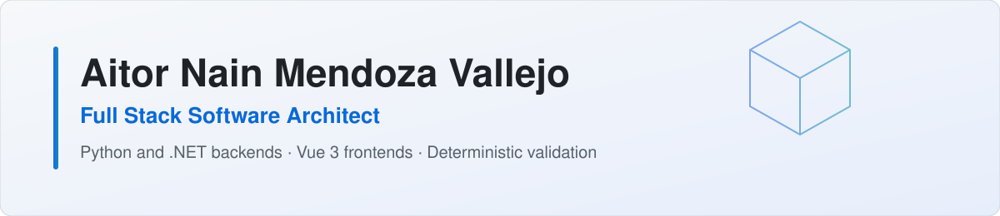
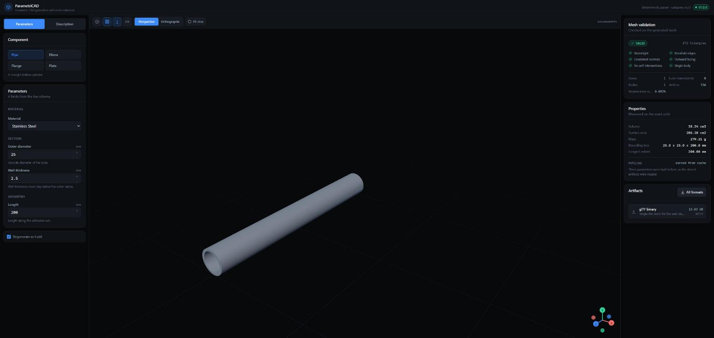
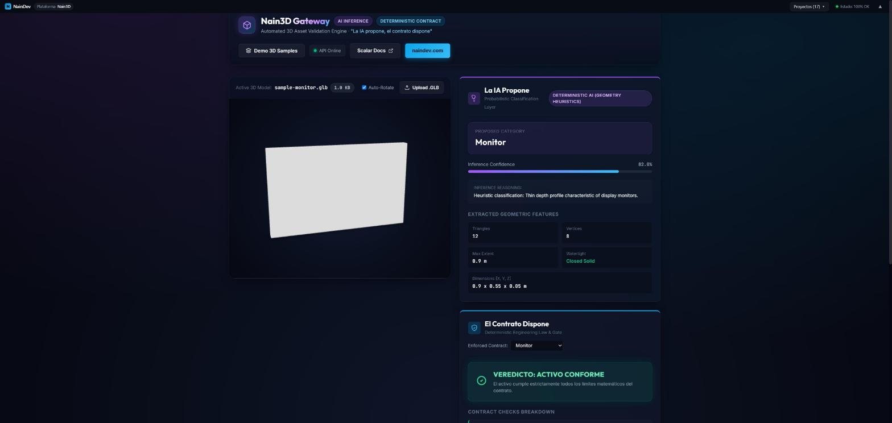
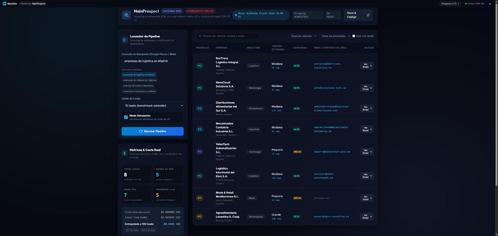
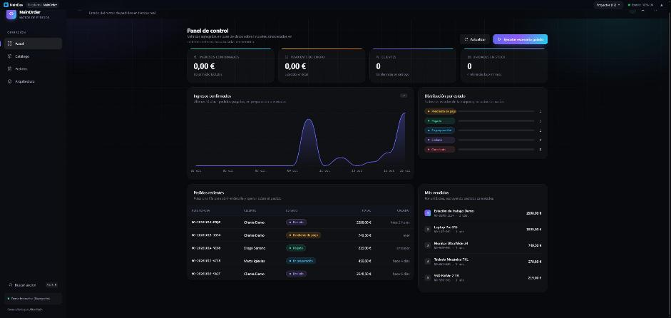
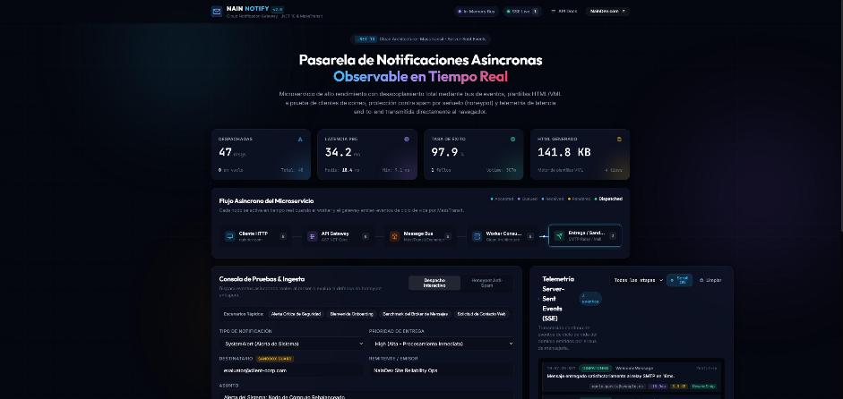
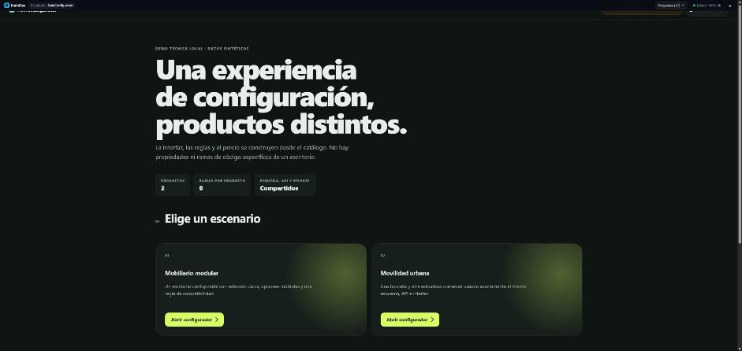

  <picture>
    <source media="(prefers-color-scheme: dark)" srcset="assets/banner-dark.svg" />
    
  </picture>

  
Madrid, Spain &bull; CTO at <a href="https://github.com/naindev-contrast3d">Contrast3D x NainDev</a>

  

    
    
    
    
  

  

    
    
  

## What I build

<table>
  <tr>
    <td width="33%" valign="top">
      <b>Backends and APIs</b> 
      Python (FastAPI) and .NET (C#) services on PostgreSQL or SQL Server, with tested contracts. Also maintenance and incremental modernization of legacy .NET.
    </td>
    <td width="33%" valign="top">
      <b>Deterministic validation</b> 
      3D and CAD checks that give the same verdict every time, with reproducible reports and AI tools that work under human oversight (MCP).
    </td>
    <td width="33%" valign="top">
      <b>Complete web apps</b> 
      Accessible Vue 3 and TypeScript frontends (WCAG 2.2 AA), delivered with Docker and continuous integration.
    </td>
  </tr>
</table>

## System Architecture & Engineering Standards

The portfolio applications operate as an integrated platform of autonomous Bounded Contexts (DDD):

- **[Enterprise Context Map & Topology](https://github.com/Nain9Dev/engineering-handbook/blob/main/architecture/enterprise-context-map.md)**: C4 Level 1/2 architectural blueprints, asynchronous domain event routing over RabbitMQ, and boundary contracts.
- **[Architectural Fitness Functions](https://github.com/Nain9Dev/engineering-handbook/blob/main/architecture/fitness-functions.md)**: Automated CI checks (`NetArchTest` in .NET, AST inspection in Python) enforcing layer boundary isolation.
- **[FinOps & Production Capacity Model](https://github.com/Nain9Dev/engineering-handbook/blob/main/architecture/finops-capacity-planning.md)**: Two-tier cost modeling from 0,00 EUR portfolio demonstration to 10k req/min enterprise production.

## Featured projects

<table>
  <tr>
    <td width="33%" valign="top">
       
      <b>ParametriCAD AI</b> 
      Deterministic CAD engine and 3D viewer. Exact solids, mesh topology checks, GLB, STEP and STL export. 
      <a href="https://parametricad.naindev.com/">Live demo</a> &middot; <a href="https://github.com/Nain9Dev/parametricad-ai">Code</a>
    </td>
    <td width="33%" valign="top">
       
      <b>3D AI Conformance Demo</b> 
      3D asset validation gateway with byte-level checks and reproducible reports. 
      <a href="https://3d.naindev.com/">Live demo</a> &middot; <a href="https://github.com/Nain9Dev/Nain3D">Code</a>
    </td>
    <td width="33%" valign="top">
       
      <b>NainProspect</b> 
      B2B prospecting gateway with AI categorization and a legal opt-out gate (FastAPI, Vue 3). 
      <a href="https://prospect.naindev.com/">Live demo</a> &middot; <a href="https://github.com/Nain9Dev/NainProspect">Code</a>
    </td>
  </tr>
  <tr>
    <td width="33%" valign="top">
       
      <b>NainOrder</b> 
      E-commerce order engine on Clean Architecture, tactical DDD and CQRS (.NET). 
      <a href="https://order.naindev.com/">Live demo</a> &middot; <a href="https://github.com/Nain9Dev/NainOrder">Code</a>
    </td>
    <td width="33%" valign="top">
       
      <b>NainNotify</b> 
      Asynchronous email dispatch with the HTTP gateway separated from the worker (.NET, RabbitMQ). 
      <a href="https://notify.naindev.com/">Live demo</a> &middot; <a href="https://github.com/Nain9Dev/NainNotify">Code</a>
    </td>
    <td width="33%" valign="top">
       
      <b>NainConfigurator</b> 
      Catalog-driven B2B product configurator with multi-company isolation (ASP.NET Core, React). 
      <a href="https://configurator.naindev.com/">Live demo</a> &middot; <a href="https://github.com/Nain9Dev/NainConfigurator">Code</a>
    </td>
  </tr>
</table>

<b>More projects (10)</b>

| Project | What it is | Links |
|---|---|---|
| **NainLegacyModernizer** | Zero-downtime legacy .NET modernization harness. Strangler Fig reverse proxying via YARP with dual-write shadow running (.NET 10). | [Code](https://github.com/Nain9Dev/NainLegacyModernizer) |
| **nain-mcp-validator** | Standalone Model Context Protocol (MCP) server for deterministic 3D mesh invariant checks (C1-C10) and content addressing. | [Code](https://github.com/Nain9Dev/nain-mcp-validator) |
| **NainPolicy** | Policy lifecycle API with per-organization isolation and optimistic concurrency (.NET 10, SQL Server, Vue 3). Uses synthetic data. | [Live](https://policy.naindev.com/) &middot; [Code](https://github.com/Nain9Dev/NainPolicy) |
| **NainTAI** | Civil service exam simulator with server-side marking and an offline-capable client (.NET 10, PostgreSQL, React 19). | [Live](https://tai.naindev.com/) &middot; [Code](https://github.com/Nain9Dev/NainTAI) |
| **NainDrive** | Deterministic billing engine with decimal arithmetic that reconciles exactly (Python, Vue 3). | [Live](https://drive.naindev.com/) &middot; [Code](https://github.com/Nain9Dev/NainDrive) |
| **NainWrite** | Spanish text rewriting workbench with semantic preservation checks (TypeScript, Web Workers). | [Live](https://write.naindev.com/) &middot; [Code](https://github.com/Nain9Dev/NainWrite) |
| **HaveTickets** | Cinema ticketing and seat reservation (.NET 10, Blazor WebAssembly). | [Live](https://tickets.naindev.com/) &middot; [Code](https://github.com/Nain9Dev/HaveTickets) |
| **GameHaven** | Indie game storefront modernized from a desktop app to the web (.NET 10, Vue 3). | [Live](https://gamehaven.naindev.com/) &middot; [Code](https://github.com/Nain9Dev/GameHaven) |
| **Orbe Runner 3D** | 3D arcade runner without a game engine (TypeScript, Three.js). | [Play](https://orbe.naindev.com/) &middot; [Code](https://github.com/Nain9Dev/Orbe3D) |
| **Pong Arcade 3D** | Browser 3D game with reproducible matches (TypeScript, Three.js). | [Play](https://pong.naindev.com/) &middot; [Code](https://github.com/Nain9Dev/PongArcade) |

## Stack

  

<b>How I work</b>

- **Spec first.** Every change starts in a specification, never directly in code.
- **Nothing claimed without a test.** A requirement without a test that proves it is not done.
- **Human in the loop.** AI agents act through MCP tools with deterministic checks and human approval, and fail closed when unsure.

## Work with me

Open to part-time, remote projects in backend and API development, legacy .NET modernization and deterministic validation.

**[contact@naindev.com](mailto:contact@naindev.com)** &middot; [naindev.com](https://www.naindev.com/) &middot; [LinkedIn](https://www.linkedin.com/in/aitor-nain-mendoza-vallejo/)
